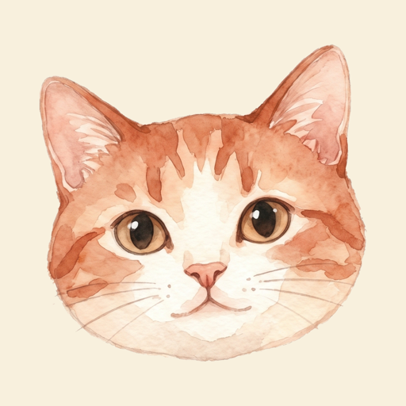
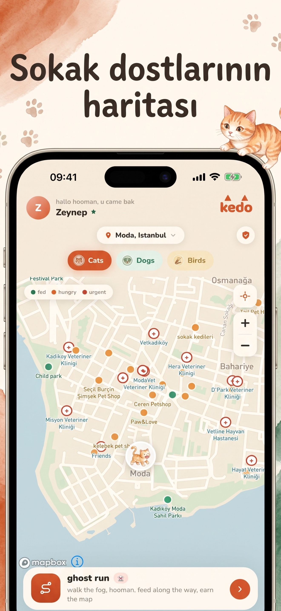
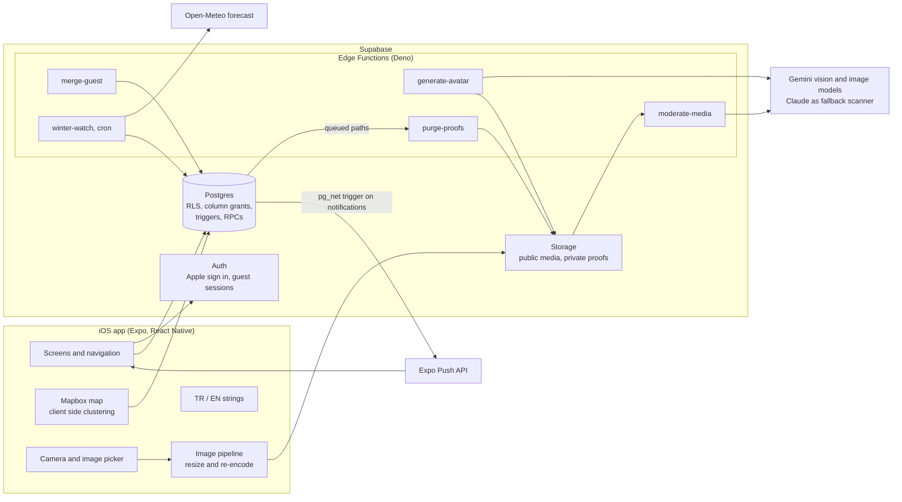
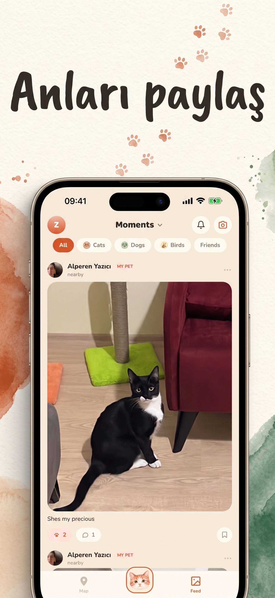
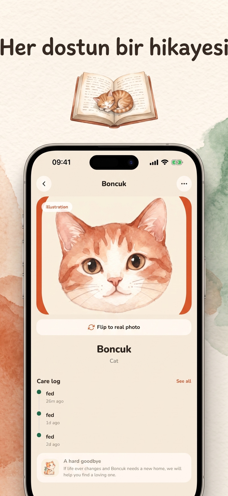
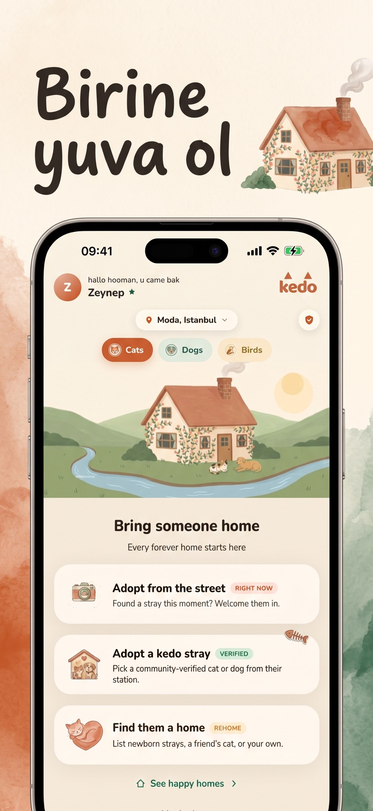
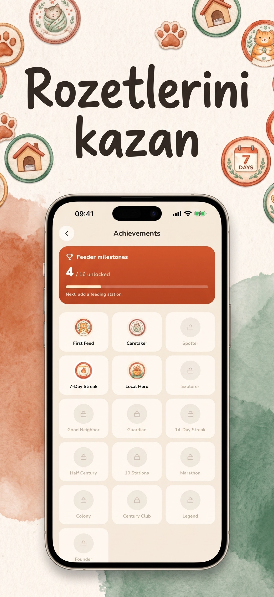
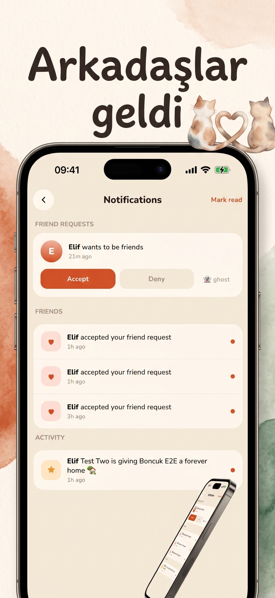

# kedo

**A kinder map for street animals.** An iOS app where neighbors map feeding stations, verify them on site, log feedings and find homes for strays.

[App Store](https://apps.apple.com/tr/app/kedo-street-animal-map/id6789555277) · [kedo.pet](https://kedo.pet) · iOS · Expo / React Native · Supabase

## The problem

Turkey's cities share their streets with millions of cats and dogs, and most of their food comes from neighbors who leave bowls on corners. That care is real but invisible: nobody knows which bowls are empty tonight, and publishing exact locations can put animals at risk from people who want to harm them. kedo makes the care network visible while treating an animal's precise location as something you earn, not something you get.

## What it does

- **Live map of feeding stations** with bowl status (fed, hungry, urgent), species filters for cats, dogs and birds, and pins that cluster as you zoom out.
- **On site verification.** You add a station while standing at it, with a photo. It becomes real only after other people confirm it in person, each with their own photo.
- **Guarded locations.** Public pins are rounded to roughly 110 m. Precise spots unlock through a trust ladder (visitor, pledged, contributor, guardian) and every reveal is logged.
- **No harm pledge.** New users sign a pledge before they can contribute.
- **Animal pages** with a care log, "I fed" check ins, feeding history and optional illustrated avatars.
- **Moments feed** for sharing photos of the animals you look after, with friends, comments and notifications.
- **Adoption:** adopt a community verified stray, take one home straight from the street, or list an animal that needs a new home.
- **Lost and found, leaderboard and achievements** (16 badges, streaks) to keep people coming back.
- **Today's kedo run:** a suggested walking loop through the hungry bowls near you.
- **Winter watch:** a nightly push when tonight's low in your area means bowl water will freeze.
- **Turkish and English** throughout, with a manual language override.

## How it works

The app talks to Supabase directly through `supabase-js`. Business rules live in the database (row level security, column grants, triggers and RPCs), so a modified client cannot bypass them. Edge Functions handle anything that needs the service role or a third party key, and those keys never ship in the app.

## Engineering highlights

- **Location privacy enforced by Postgres, not the UI.** Stations store raw coordinates, but clients only have SELECT on generated `lat_fuzzed` / `lng_fuzzed` columns (rounded to 3 decimals, about 110 m). Precise coordinates come only from a `station_location()` RPC that checks trust tier and proximity, writes an audit row, rate limits reveals per 24 hours, and freezes access while a user has an open report.
- **Weighted community verification.** A trigger scores approvals (trusted feeders count double, the submitter is excluded, one vote per user) and flips a station to verified at a score of 3. Unverified stations carry a 14 day expiry. Animals can only be attached to verified stations.
- **Small storage by design.** Once a station verifies, the extra proof photos are queued by a trigger and deleted by the `purge-proofs` function through the Storage API (Supabase blocks direct DML on storage tables). Storage grows with the number of stations, not with activity.
- **Photo pipeline.** Every upload is downscaled to a 1600 px long edge and always re-encoded to JPEG, which also strips EXIF GPS from gallery picks so a photo can never leak where it was taken.
- **Automated UGC moderation.** Uploaded media is scanned by a vision model before a post goes live (Gemini first, Claude as fallback when Gemini errors or runs out of quota). A database gate refuses posts whose photo has no clean scan, and flagged files are deleted immediately. Report, block, remove and in app account deletion cover App Store Guideline 1.2.
- **Guest to account migration.** Guests browse with anonymous sessions; database triggers seal guest writes. When a guest signs in with Apple, the `merge-guest` function moves their data to the new account, but only after verifying live tokens for both identities.
- **Push notifications from the database.** An insert into `notifications` fires a trigger that calls the Expo Push API through `pg_net`. Delivery is fire and forget, so a push failure never blocks the write that caused it.
- **Avatar generation that keeps identity.** `generate-avatar` asks a vision model for the animal's head bounding box, crops to it, and gives the image model both the close up and the full photo, so a black cat stays a black cat.
- **Privacy aware weather.** Winter watch rounds coordinates to about 1 km before they leave the database and makes one forecast request per area, not per person.
- **Map clustering without screen math.** Pins are bucketed in a geographic grid whose cell size follows the zoom level, with longitude scaled by cos(latitude). Pending stations are never clustered so their "needs confirmations" state stays visible.
- **Lightweight i18n.** Strings are written inline as `t('english', 'türkçe')` across 600+ call sites, so each language keeps its own voice. Device locale is the default and users can override it in Settings.
- **Schema as code.** 40 ordered SQL migrations with 59 RLS policies, plus a `Database` type generated from the live schema for typed queries.

## Tech stack

| Layer | Technology |
| --- | --- |
| App | Expo SDK 56, React Native 0.85, React 19, TypeScript |
| Navigation and UI | React Navigation (native stack, bottom tabs), react-native-svg, expo-linear-gradient, Expo Google Fonts |
| Maps and device | @rnmapbox/maps, expo-location, expo-camera, expo-image-picker, expo-image-manipulator, expo-video, expo-haptics |
| Sharing | react-native-view-shot for shareable story cards, expo-sharing |
| Backend | Supabase: Postgres with RLS, Auth (Sign in with Apple, anonymous guests), Storage, Edge Functions (Deno), pg_net |
| AI | Gemini (moderation, avatar generation), Claude (moderation fallback) |
| Notifications | expo-notifications, Expo Push API |
| External data | Open-Meteo |
| Release | EAS, Xcode, App Store Connect |
| Web | Static legal and support site on GitHub Pages at kedo.pet (EN / TR) |

## Screenshots

These are the App Store marketing slides, so the captions are in Turkish.

<table>
  <tr>
    <td align="center"> Map of feeding stations</td>
    <td align="center"> Moments feed</td>
    <td align="center"> Animal page and care log</td>
  </tr>
  <tr>
    <td align="center"> Adoption options</td>
    <td align="center"> Achievements</td>
    <td align="center"> Friends and notifications</td>
  </tr>
</table>

## Status and role

Designed and built end to end by Alperen Yazıcı: product, UI, mobile app, database, edge functions, moderation, App Store submission and the kedo.pet site. kedo is live on the App Store (first release July 2026), with version 1.3.0 prepared for the next submission. The source code is private and available on request.
